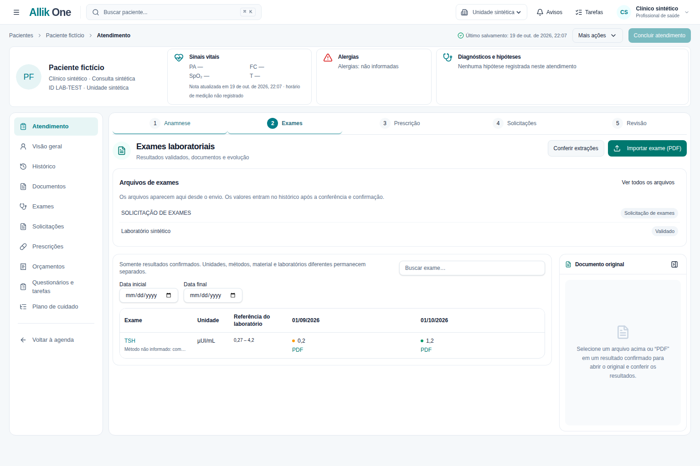
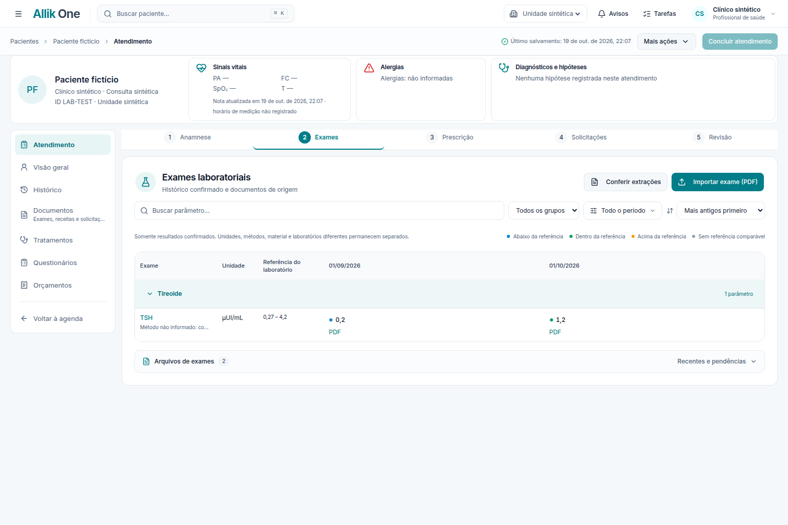

# Allik One — Teste B de UX 2.0

**Data:** 19 de outubro de 2026, horário de Brasília.
**Repositório:** `atpmktagencia/allik-one`.
**Branch experimental:** `experiment/test-b-atendimento-exames`.
**Base congelada:** `75c416e819afb557f07c8d2ab19d568ddeefe0c8`, ponta de `feature/allik-patients` no início da implementação.
**Escopo:** Atendimento, Anamnese, Exames, Prescrição, Solicitações, Revisão e contexto longitudinal do Prontuário.

## 1. Resultado e limites da entrega

Foi implementado um candidato B real, com interface ligada aos serviços existentes, testes e screenshots de homologação local. Não é uma apresentação estática nem uma nova aplicação de demonstração. O candidato pode ser comparado com o baseline A sem substituir a branch de origem.

O resultado está **pronto para avaliação visual e técnica como experimento**, mas **não representa aprovação integral de todos os critérios de UX 2.0 nem autorização de produção**. Permanecem pendências de biblioteca unificada do compositor, duplicação/desfazer de solicitações e recuperação durável de composição ainda não inserida, detalhadas na seção 8. Uma falha de integração de alergias também permanece, reproduzida no baseline.

A implementação não realizou merge em `main` ou `feature/allik-patients`, não alterou configuração de Vercel/Neon/Lovable, não solicitou deploy nem promoveu alterações à produção. As escritas de teste ocorreram exclusivamente em PostgreSQL local descartável com fixtures sintéticas. Não foi homologado um deployment remoto B da Vercel; os screenshots deste relatório são do **Preview local de homologação**, não do Preview remoto anteriormente informado.

A branch de origem continuou avançando durante o trabalho. O B conserva a base congelada acima para manter a comparação rastreável. Ele não incorpora automaticamente commits posteriores de outro autor; eventual integração deverá ser separada e novamente validada.

## 2. Alterações implementadas

### Shell clínico e Anamnese

Foram reaproveitados o header global, o cabeçalho clínico, os componentes de UI e os tokens existentes. A paleta teal, o fundo frio claro, a tipografia Inter, os cards brancos e as bordas suaves continuam sendo a identidade externa. Não foi introduzida biblioteca de UI nem segundo design system.

As cinco etapas superiores continuam sendo Anamnese, Exames, Prescrição, Solicitações e Revisão. A barra foi posicionada de forma consistente para as diferentes larguras internas. No mobile, os rótulos mantêm largura mínima legível e rolagem horizontal, em vez de ficarem comprimidos.

A navegação lateral do Atendimento prioriza Atendimento, Visão geral, Histórico, Documentos, Tratamentos, Questionários e Orçamentos. Os acessos históricos continuam no Prontuário e na central documental; não houve exclusão de rotas. Sidebar não repete a aba da consulta atual com opções ambíguas de Exames/Prescrição/Solicitações.

Os blocos visuais de Anamnese estruturada e Exame físico estruturado foram retirados. Seus dados carregados e campos persistidos continuam preservados no contrato de salvamento. Editor, modelos, campos históricos, hipóteses, plano, retorno, autoria, versão, finalização e auditoria permanecem. Vitais podem ser editados pelo painel sob demanda, sem competir com o editor principal.

### Exames — principal mudança de espaço útil

A tabela longitudinal passou a ser o conteúdo central e ocupa a largura disponível. O PDF vazio e a lista permanente de arquivos acima da tabela foram eliminados do estado inicial.

Pesquisa por parâmetro, grupo, período e ordenação temporal ficam em controles compactos. A tabela mantém cabeçalho/coluna de exame fixos, rolagem horizontal e grupos recolhíveis. Datas ausentes permanecem ao final, em vez de serem tratadas como resultados mais recentes.

A seleção do parâmetro conserva os gráficos existentes. A seleção de um valor abre detalhes com valor literal, unidade, data, referência, laboratório, método/material quando presentes e acesso à origem. O detalhe é vinculado ao paciente/unidade e não permanece visível ao trocar o contexto.

O PDF original abre sob demanda em painel lateral. Ao fechar, a tabela recupera a largura. O fechamento respeita o guard de uma conferência laboratorial em edição e as URLs de origem preservam a unidade explícita do atendimento.

As cores distinguem abaixo, dentro, acima e sem referência comparável. Não foi criada faixa universal de normalidade, recomendação clínica ou comparação de métodos/unidades incompatíveis. Agrupamento visual é navegação, não normalização clínica dos resultados.

O backend de extração, correção, conferência e confirmação não foi reconstruído. Somente resultados confirmados continuam entrando no histórico. A automação E2E percorreu o fluxo de documento, revisão, valores confirmados, origem e continuidade do atendimento.

### Prescrição — compositor disponível diretamente

Um clique na aba Prescrição apresenta o compositor existente no workspace, em três áreas: protocolos/modelos, composição e prévia. O profissional não precisa criar uma receita documental antes de começar a preencher a composição.

A navegação, a troca de categorias e a troca Prescrição → Solicitações → Prescrição não criam documentos. A criação/associação ocorre por ação explícita de inserir a composição revisada, com idempotência de criação, identidade do atendimento, versão real do servidor e autorização existentes.

O cálculo de quantidades, as etapas de posologia, os campos personalizados, os modelos pessoais/compartilhados e as cópias independentes continuam utilizando o motor existente. Nenhuma dose terapêutica foi sugerida automaticamente.

O acesso **Documentos e assinatura** permite revisar o texto, salvar, finalizar, imprimir e acessar as funcionalidades documentais existentes. Ele não é uma etapa obrigatória anterior ao compositor. O registro terapêutico anterior continua acessível por **Voltar aos medicamentos**.

Foram corrigidas, durante a homologação, três regressões introduzidas pela primeira integração: uso de versão inicial presumida em vez da versão zero real; associação a um documento já finalizado; e compartilhamento indevido do estado dirty entre compositor inline e modal legado. Os testes agora cobrem o primeiro salvamento com versão zero e a manutenção do guard inline ao fechar um modal separado.

### Solicitações — criação direta e exclusão lógica segura

Na categoria Exames laboratoriais, **Solicitar exame** cria diretamente o rascunho autorizado. Encaminhamentos têm ação direta equivalente. Categorias com vários tipos documentais mantêm escolha explícita do tipo.

A lista oferece edição e **Excluir rascunho** quando o servidor confirma `canEdit` e `canDiscard`. A confirmação identifica o documento e exige um motivo auditável. A interface atualiza a coleção após a resposta; em erro de rede, mantém o rascunho e mostra a falha.

A exclusão é um **descarte lógico**, não `DELETE`: mantém ID, conteúdo, autor, unidade e histórico; grava data, motivo e ator; incrementa versão; e registra snapshots antes/depois no ledger. Documentos finalizados não têm exclusão comum. Fontes descartadas deixam de aparecer nas coleções ativas e são rejeitadas na mutação de solicitações e em tentativas de reabertura.

### Revisão e Prontuário

A Revisão apresenta cards compactos de evolução, hipóteses/diagnósticos, prescrição, solicitações, orientações/retorno e orçamento, com atalhos para a correção e pendências reais. Salvar, finalizar evolução, finalizar documento, assinar e concluir continuam operações distintas. As regras server-side de fechamento não foram substituídas por habilitação visual.

A Visão geral reaproveita seu resumo clínico, exames recentes, tratamentos, próximas consultas e pendências, usando o mesmo cabeçalho e tokens clínicos. O Histórico continua uma timeline, com eventos administrativos/clínicos identificados, categoria e período. Autoria e origem filtram os registros **já carregados**, com aviso explícito desse limite; não se apresentam como busca global em todas as páginas.

## 3. Migração e segurança

A migração aditiva `drizzle/0076_clinical_document_discard.sql` foi necessária porque o contrato anterior não representava descarte auditável de documentos. Ela acrescenta `DISCARDED`, colunas de motivo/data/ator e ação `DISCARD` no ledger, mantendo checks de lifecycle e snapshots de finais. Não apaga registros nem reclassifica dados históricos.

Foi aplicada **apenas ao banco local de homologação e aos bancos descartáveis dos testes**. Não foi aplicada ao Neon, Preview remoto ou produção. Um Preview remoto do B precisa de uma branch de banco própria, revisão dessa migração e provisionamento explícito antes de ser considerado homologado.

As mutações mantêm organização, unidade, permissão, profissional responsável, autoria, versão otimista e lock do atendimento. A separação entre descartado e ativo também foi aplicada aos guards de reatribuição/claim; o guard de registros finais continua protegendo sua história.

A role restrita de runtime foi verificada localmente. Nenhuma chave, `.env`, token de sessão ou dump de banco foi incluído no repositório ou pacote de evidências. `package.json`, `bun.lock`, configuração de build/deploy e automações versionadas não foram modificados.

O check de acesso da credencial de runtime retornou `verified=true` para 117 tabelas e 67 tabelas append-only. No runner de provisionamento, dois checks passaram e o teste transacional com owner foi omitido por ausência de credencial administrativa nessa execução; não é contado como aprovado.

## 4. Componentes modificados e reutilizados

| Área                    | Arquivos principais alterados                                                                                                                    | Reutilização preservada                                                                                     |
| ----------------------- | ------------------------------------------------------------------------------------------------------------------------------------------------ | ----------------------------------------------------------------------------------------------------------- |
| Shell/Anamnese/Revisão  | `care-encounter-page.tsx`, `clinical-patient-header.tsx`, `clinical-workspace.css`, novo `clinical-longitudinal-nav.tsx`                         | Header global, cabeçalho, editor e modelos, vitais, alerts, guards e contratos de nota                      |
| Exames                  | `encounter-exams-panel.tsx`, `laboratory-history.tsx`, novo `clinical-exams-workspace.css`                                                       | `LaboratoryReview`, parser/comparabilidade, gráficos, histórico confirmado, central de documentos           |
| Prescrição/Solicitações | `encounter-documents-card.tsx`, `prescription-composer.tsx`, `encounter-document-workspace.css`                                                  | Motor de composição, modelos privados/compartilhados, rich editor, impressão, assinatura, entrega e versões |
| Longitudinal            | `patient-workspace-navigation.tsx`, `patient-timeline-page.tsx`, `patient-clinical-plans.tsx`                                                    | Visão geral, APIs de timeline, planos e arquivamento já existentes                                          |
| Descarte                | `encounter-documents.ts`, `clinical-requests.ts`, `clinical-record-guard.ts`, `care-encounter.ts`, `schema.ts`, migração 0076 e metadata Drizzle | Autorização, ledger, locks, lifecycle e finalização existentes                                              |
| Regressões              | Suites de UI afetadas, novos testes inline/descarte, três E2E de navegação ajustados                                                             | Asserções de conteúdo, autoria, origem, versão, impressão e modelos preservadas                             |

## 5. Comparação de interações

**Método:** ponto inicial é o atendimento já carregado em desktop 1536×1024. Navegar diretamente à rota não conta como clique. Cada clique ou tecla de fechamento é uma interação; preenchimentos clínicos, revisão e confirmação de assinatura/finalização não são eliminados. A tabela distingue execução de navegador de contagem por inspeção do caminho. Não é um teste cronometrado com médicos e não mede produtividade clínica real.

| Fluxo do briefing                    |                                           A |                                           B | Evidência e interpretação                                                                                                                                                  |
| ------------------------------------ | ------------------------------------------: | ------------------------------------------: | -------------------------------------------------------------------------------------------------------------------------------------------------------------------------- |
| Abrir atendimento e começar Anamnese |                      0 passos após carregar |                                           0 | Editor imediato nos dois. B remove concorrência dos dois formulários redundantes. A/B executado.                                                                           |
| Consultar Exames durante evolução    |                                           1 |                                           1 | Aba Exames nos dois; ganho B é largura e progressive disclosure, não menor número de cliques. A/B executado.                                                               |
| Abrir compositor                     |                                           4 |                                           1 | A: Prescrição → Novo documento → Receita → Compor. B: Prescrição. A/B executado; redução de 75% nesse acesso.                                                              |
| Adicionar medicamento/componente     |                               Componente: 1 |                               Componente: 1 | Adicionar componente com compositor aberto foi executado. Não equivale a selecionar medicamento do catálogo nem contabiliza dose/via. Biblioteca unificada ainda pendente. |
| Carregar protocolo                   | Não cronometrado/quantificado separadamente | Não cronometrado/quantificado separadamente | Seleção, cópia privada e independência do modelo foram validadas nos E2E; não atribuo redução de cliques sem medição específica.                                           |
| Solicitar exame                      |               2 após entrar em Solicitações |               1 após entrar em Solicitações | A menu + tipo; B botão direto. Contagem por inspeção dos controles e dos E2E executados; não foi uma medição A/B isolada. Incluindo aba, 3 → 2.                            |
| Excluir solicitação em rascunho      |                         Ação não disponível |                          Ação + confirmação | Capacidade nova; não é possível calcular redução percentual contra um fluxo ausente. UI e integração executadas; motivo obrigatório preservado.                            |
| Consultar Histórico                  |                                           1 |                                           1 | Sidebar abre histórico somente leitura sem sair da consulta. A/B executado.                                                                                                |
| Retornar à consulta                  |                                           1 |                                           1 | Escape fecha o histórico. A/B executado.                                                                                                                                   |

Os registros brutos das seis medições de acesso estão em `test-b/evidence/interactions-baseline.json` e `test-b/evidence/interactions-current.json`. O preenchimento farmacêutico, a assinatura e a conferência clínica permanecem responsabilidades explícitas, não operações removidas para melhorar uma métrica.

## 6. Testes executados e resultados

| Verificação                      | Resultado final                        | Observação                                                                                                     |
| -------------------------------- | -------------------------------------- | -------------------------------------------------------------------------------------------------------------- |
| `npm run typecheck`              | Passou                                 | TypeScript completo, sem erros                                                                                 |
| `npm run lint`                   | Passou, 0 erros                        | Seis warnings de Fast Refresh em componentes de UI existentes                                                  |
| `npm run build`                  | Passou                                 | Banco unset e `INVENTORY_PREPARE_PREVIEW=false`; não preparou Preview nem executou migração remota             |
| `npm test`                       | **506/506 passaram**, 78 arquivos      | Suite unitária completa no toolchain fixado                                                                    |
| Integração em banco novo         | **422 passaram, 1 falhou**, 423 testes | Alergias: justificativa de 500 caracteres retorna 500 em vez de 201                                            |
| Descarte — integração focalizada | 3/3 passaram                           | Estado/versionamento, ledger, conteúdo, finais, autoria/unidade, filtragem e rejeição de reabertura            |
| Guard de Preview                 | 8/8 passaram                           | Inclui proteção de produção e journal de migrações crescente                                                   |
| Role restrita/runtime            | Passou localmente                      | Provisionamento e verificação independentes do resultado da suite de integração                                |
| E2E laboratório/Patient360º      | Passou                                 | Upload/revisão/validação, documentos, prescrição inline, nota, reload, impressão e continuidade do atendimento |
| E2E compositor                   | Passou                                 | Composição, campos personalizados, cálculo, rascunho e conteúdo após reload                                    |
| E2E central de documentos        | Passou                                 | Fluxos privados e documento indexado                                                                           |
| E2E planos clínicos              | Passou                                 | Plano independente, cronograma/dispensação sem efeito operacional implícito                                    |
| E2E pré-consulta                 | Passou                                 | Publicação/resposta única/revisão de respostas opcionais                                                       |
| E2E modelos compartilhados       | Passou em rerun focalizado             | Último seletor legado após reload foi atualizado; preservadas asserções de cópia independente                  |
| Screenshots comparáveis          | Capturados                             | Seis telas desktop/mobile e cinco capturas móveis de conteúdo; baseline e B com mesma fixture                  |

**A falha de alergias é preexistente:** foi reproduzida executando o mesmo teste contra o código congelado A. Não foi corrigida nesta refatoração e continua um bloqueio a uma afirmação de suite integral verde.

Uma tentativa de repetir integração no mesmo banco descartável produziu colisões de fixtures, como nomes/tokens/cadastros já existentes. Essa execução foi preservada no histórico local, mas não foi usada para declarar o resultado final. A suite foi repetida em banco novo e terminou com a única falha de alergias acima.

Falhas iniciais de seletores E2E foram corrigidas para o fluxo real B: lista de arquivos recolhida, compositor inline padrão e acesso explícito ao editor após reload. Não foram removidas as asserções clínicas para fazer os testes passarem.

Não foram executados: assinatura externa real, entrega a pacientes reais, medição de latência em produção, teste de carga ou avaliação clínica humana. A extração generativa em serviço externo não foi revalidada com PDFs de terceiros; usaram-se fixtures sintéticas do projeto.

## 7. Evidências visuais

Screenshots são capturas reais da aplicação autenticada, com paciente e profissional fictícios, e não montagens ou imagens geradas. Desktop: 1536×1024. Mobile: 390×844. Foram preservados os originais A e os estados B. As imagens de referência anexadas pelo usuário não foram reabertas durante a execução.

### Exames — comparação direta A/B

| Baseline A                                                     | Teste B                                                       |
| -------------------------------------------------------------- | ------------------------------------------------------------- |
|  |  |

### Seis telas B

- [Visão geral](test-b/screenshots/current/01-visao-geral-desktop.png)
- [Anamnese](test-b/screenshots/current/02-anamnese-desktop.png)
- [Exames](test-b/screenshots/current/03-exames-desktop.png)
- [Prescrição](test-b/screenshots/current/04-prescricao-desktop.png)
- [Solicitações](test-b/screenshots/current/05-solicitacoes-desktop.png)
- [Revisão](test-b/screenshots/current/06-revisao-desktop.png)

O pacote de evidências também contém capturas móveis, histórico e origem sob demanda. Estados sem vitais/diagnósticos ou sem modelos exibem ausência de dados; não foram preenchidos artificialmente para imitar o conteúdo do mockup.

A comparação visual foi qualitativa: identidade, shell, hierarquia, margens, abas, cards e aproveitamento horizontal. Não houve métrica pixel-perfect e não se declara equivalência exata ao mockup. O layout interno do compositor é intencionalmente diferente do editor da Anamnese, conforme a tarefa.

## 8. Pendências e riscos remanescentes

1. **Biblioteca do compositor parcialmente atendida.** Protocolos/modelos existentes estão à esquerda e seus fluxos continuam funcionais. Catálogo de ativos/medicamentos permanece acessível pelo caminho existente, mas não foi integrada uma biblioteca única à esquerda com favoritos, busca de todos os ativos e doses frequentes cadastradas. Não há botão decorativo simulando essa capacidade. Recolhimento independente da biblioteca/prévia ainda não está completo.
2. **Duplicar/desfazer solicitações não implementados.** Edição e descarte auditável estão implementados. A exclusão não tem undo; reativação silenciosa é rejeitada. Duplicação dedicada de solicitação continua pendente, mesmo havendo modelos e criação de novos documentos existentes.
3. **Composição ainda não inserida não possui recuperação durável após reload.** Ela é preservada entre abas montadas e protegida por guards ao sair. Não foi gravada automaticamente em storage do navegador. Rascunhos efetivamente salvos sobrevivem ao reload, mas abortar a confirmação de saída é diferente de recuperar um formulário após fechar forçadamente a página.
4. **Preservação de navegação tem limites.** Abas, filtros, tabela e composição montada foram cobertos; troca para outra rota usa guards existentes. Não se declara preservação universal de toda rolagem/formulário em todos os modais e recarregamentos.
5. **Alergias mantém a falha preexistente de integração.** Exige correção e rerun antes de declarar suite integralmente aprovada.
6. **Preview remoto B e infraestrutura isolada não homologados.** É necessário selecionar a branch experimental, conectar uma branch Neon exclusiva sintética, revisar/aplicar explicitamente a migração e validar deployment e acesso. Nenhuma alteração de produção foi autorizada por este trabalho.
7. **Baseline congelado e origem avançando.** A comparação é contra `75c416e`, não contra a ponta móvel atual nem exclusivamente contra `398bdde`. Integração futura dos commits posteriores exige análise de conflitos e regressão.
8. **Avaliação humana ainda necessária.** Screenshots e testes demonstram comportamento, não superioridade absoluta sobre outra ferramenta. O julgamento de design deve usar os mesmos mockups, tarefas e tolerâncias, preferencialmente sem identificar o autor A/B.

9. **Prévia privada do PDF não comprovada na captura local.** A captura `08-exames-original-desktop.png` mostra o painel sob demanda e sua mensagem de erro de carregamento da origem. A abertura/fechamento do painel e a recuperação da largura foram verificadas; essa imagem não prova renderização dos bytes do PDF. É necessário repetir com um arquivo sintético cujo armazenamento privado esteja disponível e confirmar autorização/renderização. Os testes de origem e da central documental não substituem essa homologação visual do PDF.

## 9. Como avaliar este Teste B

Compare primeiro as capturas de Exames e das seis telas, com o mesmo viewport e a mesma fixture. Em seguida, avalie os caminhos críticos: abrir Prescrição em um clique; alternar abas com composição parcial; inserir explicitamente e salvar o rascunho; retornar ao documento após reload; abrir/fechar PDF; conferir um exame; editar/descarte de solicitação; e abrir/fechar Histórico sem sair do atendimento.

Use os testes de segurança e a lista de pendências como critérios eliminatórios, não apenas a estética. A branch é um experimento separável e reversível por escolha de branch; ela não substitui a versão publicada nem constitui aprovação de uma mudança de produção.
