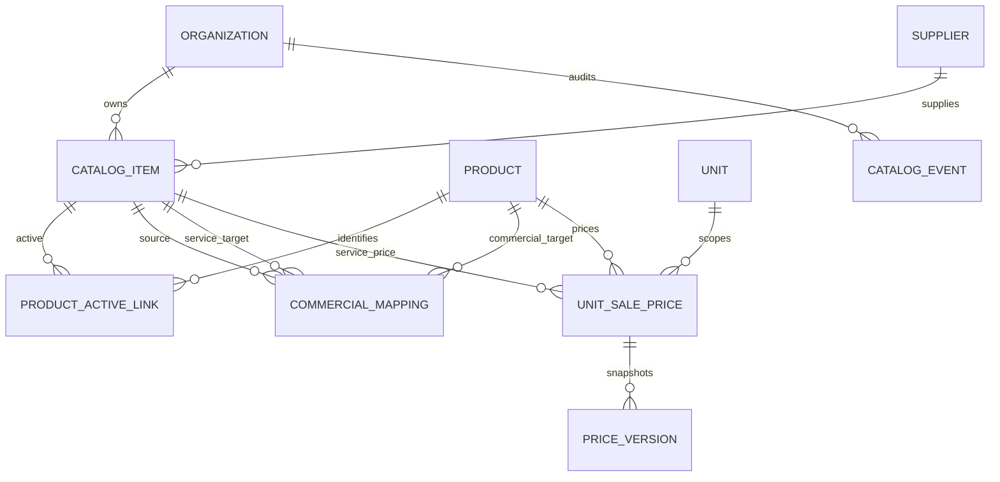

# M21B — Typed catalog and unit sale prices

Scope: incremental delivery on `feature/allik-patients`, synthetic Preview only. The architecture and the six additive structures below were presented before applying a migration. Existing SKU IDs, prescriptions, documents, inventory and quotes remain authoritative in their existing domains.

## Relationships

The six new structures are catalog items, product/active associations, commercial mappings, current unit sale prices, immutable price versions and immutable catalog events. Products reuse `inventory_products`; suppliers reuse `inventory_suppliers`. Catalog item types are ACTIVE, MEDICATION, SERVICE and PROCEDURE. An active can be associated with multiple SKUs, and a SKU can have multiple actives. Only SKUs, services and procedures can have commercial prices.

Catalog metadata includes category, measurement unit, presentation, concentration, internal code and an optional supplier. These are explicit registrations; the system does not infer doses, routes, equivalence, conversions or compatibility. The existing photo-reference list is not automatically imported as verified catalog data.

Commercial mappings explicitly identify a SKU or service/procedure target, a charge group and SEPARATE/INCLUDED billing mode. These fields prepare later quote deduplication; M21B does not yet calculate a general quote or implement its deduplication engine. Unmapped items receive no invented price.

## Price semantics

Each organization/unit/typed target has one current price head. Changes create immutable versions and audit events in the same transaction. Positive BRL amounts use decimal strings; selling unit, price source, validity dates and availability are explicit. An inactive or out-of-validity price is unavailable. There is no fallback to legacy prices, automatic name matching or previous historical versions. This is not a scheduler for multiple future price books or an historical-as-of pricing API.

The displayed reference date comes from the server in America/Fortaleza. Prescribed quantities and supplied packaging are not converted by this catalog delivery. Saving catalog or price data never creates a quote, sale, reservation, appointment, administration or stock movement.

## Access and integrity

Backend reads are organization scoped and prices additionally unit scoped. Individual catalog administrators manage catalog records; individual users with `pricing.manage` manage prices in their authorized units. Shared demonstration sessions and integration identities cannot mutate these structures. UI capabilities mirror backend authorization; hiding controls is not the enforcement boundary.

Foreign-reference validation also runs in PostgreSQL with a pinned function search path. Price history and catalog events reject updates, deletion and truncation. Requests use operation IDs and payload hashes for idempotency, with optimistic record versions for concurrent editing. Reusing an operation ID with another payload conflicts instead of silently overwriting.

## Delivery and limitations

Migrations 0000–0064 must retain their hashes and order. Migration 0065 is additive and must be tested in disposable PostgreSQL before an explicit transaction in the named Preview branch. Production is excluded. Preview is currently at its Neon branch quota; the existing recovery branch predates this delivery and must not be represented as a fresh checkpoint. Do not delete existing branches to free quota.

Remaining work follows the roadmap: shared/private/institutional templates (M21C), general clinical plans and modular dispensing (M21D), probable quote calculation and deduplication (M21E), the RECEITA/ORÇAMENTO pane (M21F), and integration events (M21G).

## Verification and activation

Validation passed: 247 unit/UI tests, 284 PostgreSQL integration tests, 12 browser E2E tests, runtime provisioning/guard checks 3/3, migration/build guards 7/7, typecheck and build. Lint has zero errors and only the six existing Fast Refresh warnings. Browser coverage includes creating a service, setting its unit price, reloading persisted data and verifying a clinician cannot edit. The new native selects use explicit accessible label associations.

All 65 existing Preview migration hashes and timestamps were verified before activation. Migration 0065 (`773805df6d0331c1e2b8de6a66f0922d4a702bde4f74de865109eb934cc91725`, journal timestamp `1794272400022`) was applied in one explicit locked transaction only to `little-dust-61663559` / `br-winter-hill-b69uz195`. Preview now has 66 migrations and six new catalog tables. The restricted runtime was granted operational CRUD and append-only SELECT/INSERT permissions. No catalog seed, real patient data, new users or email delivery were needed.

Read-only production checks confirmed the official deployment remains `dpl_4ag81mHUxsDZ7VaKqnrKKHqKrFkp` and its database retains 61 migrations. No production changes or promotion were performed. The Neon branch quota still prevents a fresh Preview recovery branch; the earlier recovery branch is preserved and is not a current checkpoint.
