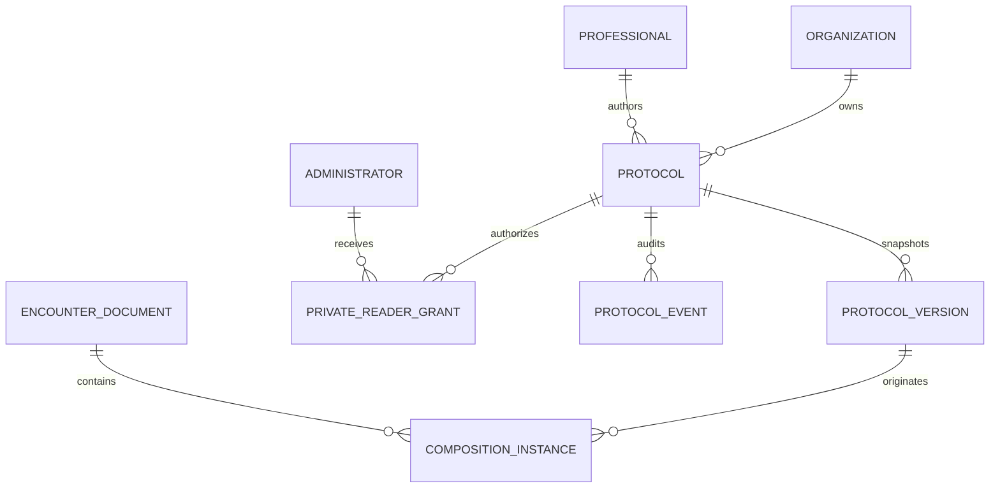

# M21C — Private, organization and institutional prescription models

Baseline: `98eca52db3e4fcfdac2b3990fb3d82a7059579aa`, 66 migrations. Scope: synthetic Preview on `feature/allik-patients`. The existing prescription protocol and immutable version tables are reused; existing protocol IDs and old personal models remain private by default.

## Proposed extension presented before migration

Protocol heads and version snapshots gain category, description, visibility (PRIVATE, ORGANIZATION, INSTITUTIONAL), workflow status (DRAFT, PENDING, APPROVED) and optional unit restrictions. Three new tables hold explicit private-reader grants, immutable governance events and immutable prescription composition instances linked to the existing encounter document.

This migration extends the existing tables and replaces their validation function in a new migration; it does not rewrite previously applied SQL or delete existing models, versions, prescriptions or documents.

## Access policy

Private content is readable only by its author or an active organization administrator explicitly granted access by that author. Administrator status alone grants no private access. Private grants are read-only; only the author edits the source. Organization models are available to authorized clinical users within the organization and any configured unit restriction. Institutional drafts/pending models are limited to their author and eligible reviewers; other clinical users see only approved revisions.

Institutional review requires the separate `clinical.templates.approve` capability, initially assigned only to SUPER_ADMIN, a valid prescribing registration, and a different person from the author. The reviewer must remain within the model's organization and applicable unit scope. Publication is an explicit approval action. Approved institutional content cannot be edited in place; a new private copy can be prepared for another review. Archives remove future library availability without rewriting existing instances.

The existing appointment-author, patient-active, patient-current-unit and appointment-original-unit checks remain in force. Shared demonstration and integration sessions cannot compose, grant private access or approve models. Backend authorization is the access boundary; this delivery does not introduce RLS into an application that currently uses scoped backend services and a restricted SQL runtime.

## Independent use and privacy

Loading a model creates an independent editor copy. Source edits require a separate explicit owner action. On reviewed insertion, the backend creates an immutable composition instance with the entered formula, appointment/document/author identity and optional exact source revision. Source changes cannot rewrite that copy or older clinical documents. Instance persistence does not finalize or sign a document; the normal explicit draft/finalization workflow remains.

Model payloads contain no patient/appointment identifiers. The save flow requires an explicit confirmation that reusable content contains no patient identity. Strict schemas and checks for identifiable data supplement review; free-text detection cannot establish that arbitrary text is anonymous. Patient information belongs in the clinical instance/document, never in a shared reusable model. No clinical doses, routes or compatibility are inferred.

## Rollout boundary

Validate in disposable PostgreSQL and browser before explicitly applying migration 0066 only to Preview `little-dust-61663559` / `br-winter-hill-b69uz195`. Preserve all hashes through 0065. Preview has already reached its Neon branch quota; the earlier recovery branch is preserved but is not a current checkpoint. Production deployment and database remain excluded.

This delivery does not implement a general clinical plan, commercial quote engine or the new ORÇAMENTO pane. Those remain M21D–M21G in the [roadmap](prescription-engine-roadmap.md).

The source revision records provenance rather than a claim that the instance formula is unchanged; the clinician may explicitly adapt their copy. When saving a new reusable copy, the UI selects the newly saved model revision returned by the server. A new review is required before insertion. Source reference checks fail closed if that model has since changed, been archived or become inaccessible; after an ambiguous insertion response, such a change can require refreshing the model even when an earlier instance exists. The prior immutable instance remains preserved.

## Verification and activation

Validation passed: 250 unit/UI tests, 295 PostgreSQL integration tests, 13 browser E2E tests, runtime provisioning/guard checks 3/3, migration/build guards 7/7, typecheck and build. Lint reports zero errors and only the six pre-existing Fast Refresh warnings. New coverage includes private denial to an uninvited SUPER_ADMIN, explicit read-only grants/revocation, unit restrictions even for owners, institutional self-approval denial, approval/rejection by a different registered reviewer, PII confirmation, immutable versions and instances, API integration/shared-session denial and independent copies. Browser tests save a private copy of an organization model and confirm the persisted prescription remains unchanged when the source is later edited.

Migration 0066 was applied only to Preview `little-dust-61663559` / `br-winter-hill-b69uz195`, in an explicit transaction with an advisory lock, migration-journal lock and verification of all 66 previous hashes/timestamps. Applied SQL hash: `84b1187ef570caf8a381fd5f9634abffd359afc3e2628013256e24cd9fb49047`; journal timestamp: `1794272400023`. Preview now has 67 migrations. Restricted runtime access to the three new tables was verified; instances/events have SELECT/INSERT and no UPDATE/DELETE grants. No seed, real records, account creation, invitations or email delivery were required.

Read-only checks confirmed production still points to deployment `dpl_4ag81mHUxsDZ7VaKqnrKKHqKrFkp` and retains 61 migrations. No production migration or promotion was performed. The existing Neon branch-quota limitation remains; this activation did not create a fresh recovery checkpoint or delete existing branches.
