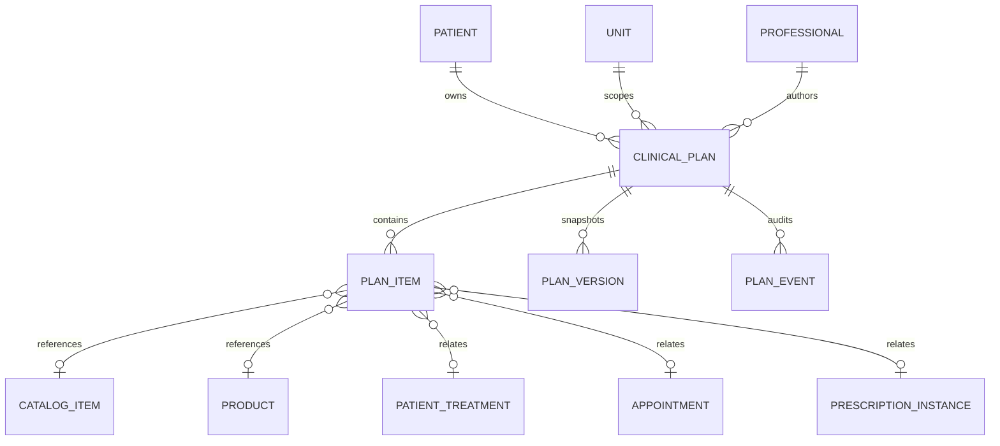

# M21D — Independent clinical plans and modular quantity calculation

Baseline: `d7b8208a57e7246876512de22b64e8beed52f0da`, 67 migrations. Scope: incremental synthetic Preview delivery. The existing product-specific patient treatments, clinical documents, appointments, operational schedules and stock workflows are preserved.

## Design presented before migration

Four additive tables represent the clinical plan header, stable plan items, immutable full plan versions and immutable idempotent events. Existing patient, unit, professional, catalog, SKU, treatment, appointment and prescription-instance identities are reused through explicitly validated references.

Intervention kinds distinguish prescriptions, procedures, consultations, injectable sessions, services and returns. Optional items remain clinical choices; there is no commercial approval or price attached. A plan status does not imply execution, a finalized prescription, an appointment booking, a sale or stock consumption. Product-specific treatments are referenced without copying or replacing their operational state.

## Modular calculations

The pure calculation module accepts explicit calendar dates, administration units, successive stages, dose per administration, daily frequency, cadence, optional weekdays and optional times. Calendar-day stage boundaries are separate from the days on which administration occurs. Date-only arithmetic does not depend on the server timezone; the UI uses the clinic's America/Fortaleza calendar convention.

No missing dose, frequency, time, route, concentration or conversion is inferred. An indefinite final stage has no finite total. Unknown quantities remain unknown. Preview horizons and output event counts are bounded, with truncation reported separately from finite total calculation.

Quantities prescribed for dispensing are separate from calculated administration units. Commercial package counts require an explicitly entered capacity in exactly the same unit as the entered dispensing quantity. Decimal arithmetic and upward package rounding must be exact. Capsule, pack, sachet, vial, ampoule or syringe equivalences are never inferred from names or presentations. This is planning arithmetic, not pharmacy validation or a medication recommendation.

## Safety and integrity

Only individual authorized clinical identities can access these plans. Writes require a valid professional registration and the author; prescription items retain the application's conservative CRM prescribing policy. Both the plan's original unit and patient's current unit are checked. References must belong to the same organization and patient where applicable, and to authorized units. Commercial personnel do not gain access to this clinical payload through quote permissions.

All aggregate changes use optimistic versions, operation IDs and request hashes in a single transaction, with immutable snapshots and audit events. Stable item identity is preserved; removing an item does not erase earlier plan versions. Database scope/type validation complements backend authorization. Unit switches clear editor state and stale responses cannot cross the selected context.

## Deployment boundary

Test migration 0067 and the full flow in disposable PostgreSQL before explicitly applying to Preview `little-dust-61663559` / `br-winter-hill-b69uz195`. Preserve every previous migration hash. Production is excluded. The existing Neon branch quota prevents a fresh recovery branch; retain earlier checkpoints and do not represent them as current.

The patient page gains an independent, lazily loaded clinical-plan section. Existing treatment creation and application flows remain separate. General probable quote calculation, price snapshots and quote deduplication remain M21E, followed by the RECEITA/ORÇAMENTO integration and domain-event contracts.

## Verification and activation

Validation passed: 288 unit/UI tests, including 35 pure calendar/dispensing cases and three plan-editor cases; 302 PostgreSQL integration tests; 14 browser E2E tests; runtime provisioning/guard checks 3/3; migration/build guards 7/7; typecheck and build. Lint has zero errors and only the six pre-existing Fast Refresh warnings. New browser coverage saves an ACTIVE plan with explicit weekdays/time and 35 capsules at 30 per package (two packages), reloads persisted data, checks a colleague cannot edit it, and confirms operational counts remain unchanged. Test identities use distinct synthetic registrations; duplicate professional registration protection is preserved.

The API bounds the body, plan list, reference choices and calendar output. Clinical reads are audited before disclosure and fail closed on audit failure. Original/current patient units, tenant/patient/reference integrity, nonauthor writes, terminal archives, idempotent replay, stale-edit races, sealed snapshots and immutable history are covered. Requests on one transactional PostgreSQL connection are awaited sequentially rather than relying on deprecated client query queuing.

All 67 existing Preview migration hashes/timestamps were checked. Migration 0067 (`0652cfa6a4f5ec2b150f57a4df8c6ca969a25037a21fc48ca9953197d30c36f5`, journal timestamp `1794272400024`) was applied in an explicit locked transaction only to `little-dust-61663559` / `br-winter-hill-b69uz195`. Preview now has 68 migrations and four new plan tables. Runtime operational CRUD and history SELECT/INSERT grants were checked; history UPDATE/DELETE are absent. No data seed, real patient records, user creation, invitations or email delivery were needed.

Production read-only checks confirmed deployment `dpl_4ag81mHUxsDZ7VaKqnrKKHqKrFkp` and 61 migrations remain unchanged. No production mutation or promotion occurred. The Neon branch quota still prevents a fresh Preview recovery branch; existing checkpoints were preserved and are not represented as current.
