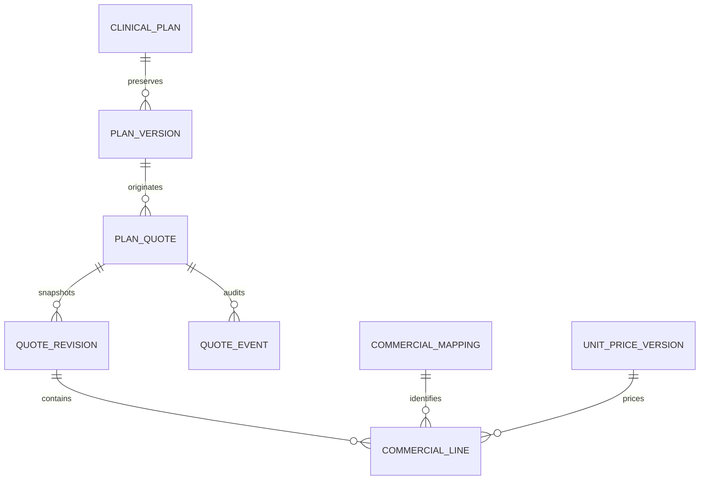

# M21E — Probable quote from an independent clinical plan

Baseline: `a98400cb69defc2ecbc8050b97a28bc424f3aa5d`, 68 migrations. This incremental delivery is restricted to synthetic Preview. Existing encounter quotes, payments, product-specific treatments and stock workflows are preserved.

## Architecture presented before migration

Three additive tables hold the estimate header, immutable commercial revisions and immutable idempotent events. Clinical plans and their immutable versions remain the clinical authority; typed catalog mappings and unit sale-price versions remain the commercial sources.

Lines are stored inside each immutable commercial snapshot rather than copied into a second mutable line ledger. Quotes remain DRAFT_ESTIMATE: “Orçamento estimado — não aprovado”. Saving does not approve a quote or create a sale, charge, booking, reservation, administration or stock movement.

## Quantity, pricing and inclusion rules

The price book is fixed to the plan's original clinic unit. The server uses the current America/Fortaleza calendar date and explicitly active mappings/prices; the client cannot supply an historical valuation date or price. Existing SKUs and catalog SERVICE/PROCEDURE entries are directly commercial identities when no active explicit mappings exist. ACTIVE and MEDICATION entries never become commercial products merely because names match.

Automatic commercial quantity requires exact unit identity with an explicit dispensing quantity (products) or finite calculated administration quantity. No names, packaging or doses are used to infer conversions. Authorized commercial users may enter an explicit commercial quantity/unit for the priced unit; this never rewrites the clinical quantity. Missing or ambiguous mappings, prices, availability or quantities remain unresolved, with “Preço indisponível” or the applicable reason. Known subtotals are explicitly partial; an unresolved selected line leaves the aggregate total unknown.

Candidates deduplicate by clinical origin item, charge group and typed commercial target. Distinct clinical interventions are not collapsed solely because they use the same SKU. INCLUDED components are excluded from the sum only when a SEPARATE anchor in the same origin/group is resolved; orphan or unresolved inclusion groups remain pending. This increment does not infer a common protocol group across distinct plan items; any future cross-item bundle requires an explicit aggregate identity.

Amounts use exact integer cents and four-decimal quantities. Each line rounds half up to cents; percentage discounts round half up on the sum of rounded lines. Initial discount policy is SUPER_ADMIN only, from zero through 10,000 basis points; all other roles have a zero discount limit. This is an explicit initial policy, not a delegated unit discount-policy editor. Only clinically optional items may be excluded from an estimate, without removing them from the clinical plan.

## Snapshots, access and governance

Each revision records the source plan version, quote unit/reference date, commercial identities, mapping IDs, selected quantities, price IDs/versions, origins and validity dates. Reading an old revision does not reprice it. Recalculation is explicit and checks the expected current source-plan version. Immutable versions retain prior prices after later catalog or plan edits.

Individual `quotes.manage` identities are organization/unit scoped. The plan's original unit and patient's current unit both remain required. Shared demonstration and integration sessions cannot manage these estimates. Commercial projections contain only the identity needed for the proposal and commercial lines; they omit the clinical plan title, formula, doses, clinical instructions, costs, margins and commissions. Backend allowlists enforce the boundary independently of the interface.

A lazily loaded quote tab appears on saved clinical-plan details. A separate commercial estimate desk supports authorized staff without fetching the clinical-plan payload. Optimistic versions, operation IDs and request hashes protect updates/retries. Changes to commercial selections never mutate the prescription or clinical plan.

## Rollout boundary and remaining scope

Test migration 0068 in disposable PostgreSQL before explicit activation only in Preview `little-dust-61663559` / `br-winter-hill-b69uz195`, preserving all 68 prior migration hashes. Production is excluded. The existing Neon branch quota prevents a fresh recovery branch; retain earlier checkpoints and do not describe them as current.

This increment estimates and snapshots commercial proposals. It does not implement approval, payment terms, automatic extra-service selection outside the clinical plan, sale/payment execution or stock consumption. The full prescription RECEITA/ORÇAMENTO pane is M21F; integration contracts and further commercial lifecycle work remain later deliveries. Paper prescription signature remains unchanged.

The displayed preview is bound to saving by a server-generated SHA-256 digest. SAVE recomputes the current commercial context and rejects a changed digest before writing, requiring the user to recalculate prices/mappings rather than silently saving a different total. Successful operation replays remain idempotent even after later price changes; retries reauthorize access. A bounded fresh-transaction retry handles serialization/unique-key races without reusing a stale repeatable-read snapshot.

The UI preserves the commercial draft when switching between clinical-plan and quote tabs. Latest stored estimates can be explicitly revised with their current optimistic version; earlier revisions stay read-only. A non-SUPER_ADMIN cannot revise an existing discounted estimate, and may explicitly start a new estimate without that discount instead. Monetary rendering uses canonical decimal strings and integer formatting, preserving cents beyond JavaScript's safe integer precision. Mapping IDs and frozen billing/group/target values are recorded; this increment does not claim separately versioned mapping references.

## Verification and Preview activation

Validated with 314 unit/UI tests, 312 integration tests plus 3 runtime checks, 15 browser tests using the restricted runtime, and 7 build guards. Typecheck and production build pass; lint has only the six existing Fast Refresh warnings. The browser scenario covers clinical preparation, commercial revision, preserved historical estimates, and unchanged plan, appointments and stock.

Migration 0068 was explicitly applied only to the Preview branch above. SHA-256: `8472ea23a1c02114fd3ba037f636029c3a1c9f6cd224bd013b26cc8576d196e5`. Its journal now contains 69 migrations, preserving the 68 preceding hashes. Runtime access was checked; history tables have no UPDATE/DELETE permissions. Immutable clinical-version reads do not require row locks or expanded runtime privileges. No live patient records, users or invitations were created.

Read-only post-migration checks confirmed the production alias still points to `dpl_4ag81mHUxsDZ7VaKqnrKKHqKrFkp` and production retains 61 migrations (latest `1794272400017`). The Neon branch quota prevented a fresh checkpoint; older checkpoints were retained and are not represented as fresh recovery evidence.
