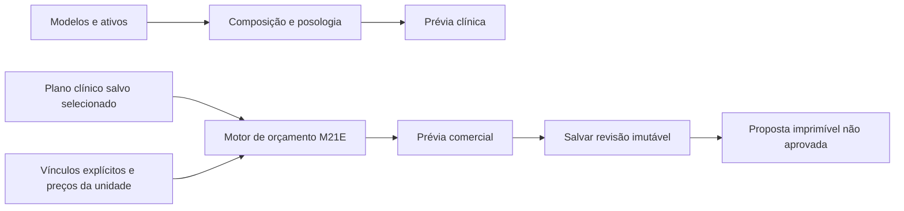

# M21F — Receita / Orçamento workspace

## Design and boundary

The structured prescription composer remains a clinical text/formula editor. Its free-text ingredients do not identify commercial products; matching a name, photo reference or dosage to a price is prohibited. M21F reuses M21E's saved-plan quote engine instead of creating a second pricing implementation.

The composer keeps the model library in the left column and clinical composition in the center; the right column contains Receita and Orçamento tabs. Switching the right-hand preview preserves the clinical draft, selected components, dosage phases and independent commercial draft. The estimate view requires explicit selection of a saved clinical plan from the same patient and appointment unit. A plan not explicitly referencing an immutable prescription instance of this document is shown as an independent estimate, not as a quote for the unsaved formula. Nothing creates or updates a plan or prescription implicitly.

The clinical view retains explicit server calculation, review and insertion into the draft. Commercial quantities, optional selections and discounts never modify clinical instructions. Estimate edits require recalculation; saving remains bound to the server preview hash and original plan revision.

## Authorization and proposal

Composer context is authenticated on the server, including individual identity, professional registration, assigned appointment, original/current unit scopes and ownership of the draft prescription. The client cannot establish access merely by supplying patient, plan or document identifiers. Existing M21E quote permissions and snapshots continue to govern estimate reads/writes.

Patient-facing proposal output comes from a saved immutable estimate revision, not browser state or current price lists. It contains commercial quantities, prices, source/reference information and explicit incomplete-price states. It excludes clinical free text, internal acquisition costs, margins and commissions. HTML values are escaped and responses are private/no-store. It is prominently marked “Orçamento estimado — não aprovado”; printing does not approve, charge, sell, schedule or reserve stock.

## Deployment scope

No schema migration is planned. Preview only; production remains pinned to its existing deployment. Verification uses disposable synthetic PostgreSQL and the restricted runtime, without creating live users or sending invitations.

## Verification

318 unit/UI tests and 319 PostgreSQL integration tests passed, including explicit saved-instance linkage, cross-organization document denial, finalized-draft denial, current-unit transfer denial, fail-closed read auditing, historical proposal pricing and escaped output. Runtime provisioning checks passed 3/3 and preview/build guards 7/7. Typecheck and production build passed; full lint retains only the six pre-existing Fast Refresh warnings, with no errors in changed files.

The browser suite exercised 15 scenarios. Additional strict geometry checks exposed a mobile dialog clipping issue; explicit viewport width limits and a zero-minimum grid track fixed it. After moving the tabs into the right column, the affected compositor scenario was rerun separately against disposable PostgreSQL and the restricted runtime. It checks the three-column structure, visible library/editor while Orçamento is active, retained formula/commercial state, explicit saved-plan selection, preserved document content, proposal opening, and unchanged stock/legacy quote records. Mobile checks use actual element positions, including the dialog, columns, tab strip and controls, rather than scroll width alone. The right tab strip remains available while scrolling commercial content.

No migration, live user creation, invitation delivery or production mutation is part of this delivery. Quote prices and unit identity come from the saved revision; the proposal labels the recipient name as current registration metadata.
