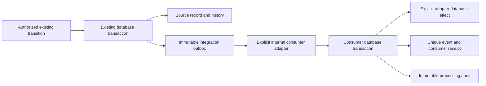

# M21G — Integration contracts and transactional events

M21G is the final planned letter of the prescription-engine roadmap. It prepares explicit integration between clinical work, commercial proposals and operations; it does not implement a sales ledger or automatically couple a prescription to consumption.

## Proposed additive model

Three new append-only tables preserve events, consumer receipts and event audit. Existing clinical documents, plan quotes, patient applications, open presentations, lot/location history and unit authorization remain authoritative.

The event and source change commit together. A failed event/audit insert rolls back the source transition. Consumer effects, receipt and audit commit together; replay returns the preserved receipt without running the adapter again. This guarantee applies to database effects executed using the supplied transaction client. External network operations require a separate delivery adapter with provider idempotency and acknowledgement; none is enabled here.

## Contracts

All envelopes carry organization, unit, stable event ID, actor, source type/ID/version and schema version. Payloads contain only source ID/version. No patient identity, prescription text, doses, prices, costs, margins or free-form notes travel in events. Source data remains behind its own authorized service.

| Event | Source | Initial emission |
| --- | --- | --- |
| PRESCRIPTION_FINALIZED | Final prescription document | Existing explicit finalization |
| QUOTE_CREATED | Saved plan estimate, revision 1 | First successful estimate save |
| QUOTE_APPROVED | Approved commercial quote | Reserved; no general estimate approval lifecycle exists |
| SALE_COMPLETED | Completed sale | Reserved; no general sales ledger exists |
| SESSION_SCHEDULED | Scheduled session | Reserved for a future explicit adapter |
| ITEM_ADMINISTERED | Recorded patient application | Existing successful scheduled application |
| STOCK_CONSUMED | Immutable open-presentation CONSUME record | Actual base-unit consumption in that application |

Opening a physical stock presentation (OUT movement) and consuming base units are distinct. Reusing an already-open presentation can consume base units without a new OUT movement. The source consumption record retains container, lot, expiry, professional and original unit traceability; events do not recalculate or duplicate it.

QUOTE_CREATED does not imply approval, a sale, scheduling, administration or consumption. Revisions preserve the same quote identity and do not pretend to be new sales. Editing or saving a prescription draft emits no finalization event. Unsupported lifecycle events remain reserved contracts, not fabricated records.

## Security and rollout boundary

Backend authorization remains on every original operation. The database validates source type/state and organization/unit consistency for emitters supported in this delivery, rejects unsupported producer transitions and forbids mutation/truncation of integration history. Internal consumers require an explicit organization/unit scope, active actor and bounded consumer identifier before execution; there is no public dispatch endpoint or automatic worker.

Test migration 0069 locally before explicit Preview activation. Preserve all 69 existing migration hashes and do not run migrations during a build. Production remains unchanged. No real users, messages, commercial charges or stock movements are needed for rollout validation.

Only new successful transitions emit events; there is no automatic backfill for historical prescriptions, estimates or applications. A directly created final prescription may have actual revision 0; its event preserves that value. Other current sources use revision 1 as validated against their immutable source. Consumer scope validation does not grant clinical/commercial/stock permissions: a future business adapter must enforce its own domain authorization and current-patient/source rules before effects.

## Verification and activation

359 unit/contract/UI tests and 328 PostgreSQL integration tests passed. Coverage includes actual prescription revision 0, first-estimate-only emission, application replay and partial presentation reuse, event/receipt uniqueness, concurrent consumers, callback rollback, receipt/audit failure rollback, disabled actors, tenant/unit denial and immutable history. All 15 browser scenarios passed using the restricted runtime. Provisioning/runtime checks passed 3/3, preview/build guards 7/7, typecheck and production build passed. Full lint has only the six existing Fast Refresh warnings.

The official local beta scenario also passed against the actual production bundle with a disposable database and restricted runtime: synthetic upgrade from migration 0012, individual clinical finalization/print/PDF, unchanged frozen PDF, permission checks, session revocation, and backup/restore. This is local verification, not evidence of provider or official production recovery.

Migration 0069 was applied explicitly only to Preview `little-dust-61663559` / `br-winter-hill-b69uz195` / `neondb`. SHA-256: `02a08f3f3019629d65eaa4aee1a8df705e837249355800e511842d64db8c5a0a`. Its journal contains 70 migrations, preserving all 69 preceding hashes and timestamps. Runtime read/insert grants were checked; rewrite, receipt deletion and audit truncation privileges are absent. The three new tables were empty at activation; no live records or users were created for testing.

A fresh recovery branch attempt was rejected by Neon's branch quota (HTTP 422); existing checkpoints were retained and are not presented as current. Read-only production checks confirmed 61 migrations, latest `1794272400017`, and the official alias remains on deployment `dpl_4ag81mHUxsDZ7VaKqnrKKHqKrFkp`.
