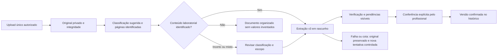

# Proposta — Central de Documentos AI-First e exames longitudinais

**Somente proposta, aguardando aprovação.** A D.2 segue aberta pelas seis inferências
reais pendentes; não iniciar esta fase antes de sua avaliação e da aprovação do
responsável. Nenhum componente, tabela, migration ou deployment desta proposta foi
implementado. Não há necessidade demonstrada de trocar fornecedor ou adicionar OCR.

## 1. Diagnóstico do que já existe

| Recurso atual                                        | Reutilização                                                                                                              | Lacuna para o fluxo desejado                                                                 |
| ---------------------------------------------------- | ------------------------------------------------------------------------------------------------------------------------- | -------------------------------------------------------------------------------------------- |
| `PatientDocumentCenter`                              | Central única, lista/tabela, busca, filtros, original/preview e preservação de contexto                                   | Upload pede nome/categorias; não há classificação automática nesse caminho                   |
| `patient-document-center.ts`                         | Agrega oito tipos de origem existentes, categorias extensíveis, permissões por organização/unidade, auditoria e paginação | Busca atual por título/profissional, não pelo conteúdo; metadata de processamento é limitada |
| Upload privado                                       | Hash SHA-256, operação estável, duplicata justificada, integridade do original, Vercel Blob privado                       | Categoria e intenção são informadas pelo cliente; upload sozinho não inicia extração         |
| `laboratory-results.ts` / `laboratory-extraction.ts` | Estados, extração v3, idempotência, limites de custo/tempo, rascunho e trilha de eventos                                  | Processamento depende de ação explícita `EXTRACT`; sem classificação de documentos mistos    |
| `LaboratoryReview`                                   | Fonte e resultados, edição, pendências e confirmação explícita por linha/lote elegível                                    | Evidência em scans e tabelas permanece trabalhosa; inventário offline não prova completude   |
| `LaboratoryHistory` e serviço                        | Somente versões confirmadas, tabela temporal, grupos, gráficos, fonte e referências                                       | Melhorar descoberta do que foi recebido mas ainda não confirmado, sem misturar os estados    |
| `EncounterExamsPanel`                                | Aba de exames com original contextual e acesso à central/revisão                                                          | Upload e revisão abrem a central; podem exigir mais ações para continuar o atendimento       |

Arquivos principais: `src/components/clinic/{patient-document-center,laboratory-review,
laboratory-history,encounter-exams-panel}.tsx`, `src/server/{patient-document-center,
laboratory-results,laboratory-extraction,laboratory-history}.ts` e
`src/lib/{laboratory-evidence,laboratory-history,laboratory-results}.ts`.

Hoje o histórico agrupa nome com normalização textual mínima e conserva unidade,
método, material e laboratório exatos. Não existe conversão clínica automática entre
essas séries. Gráficos não conectam resultados incompatíveis ou sem metadados
necessários. Preservar essa cautela ao simplificar a apresentação.

## 2. Experiência proposta

Um ponto de entrada no **Paciente360º**, acessível também pela aba Exames do atendimento.
Não criar outra biblioteca. O profissional escolhe o paciente/unidade e arrasta o arquivo
**uma vez**. O original aparece imediatamente na central e continua acessível se qualquer
processamento falhar. Categoria ou nome sugeridos não bloqueiam o recebimento.

Fluxo de leitura e decisão:

Classificação e processamento podem ser automáticos; **publicação clínica não**.
O paciente não será vinculado automaticamente apenas por nome encontrado no PDF.
Divergência de identidade deve interromper a confirmação e ser tratada pelo profissional.

### Central

Superfície branca, fundo cinza muito claro, destaque teal, toolbar compacta. Manter
paciente e navegação contextual, sem dashboard adicional. Categorias, busca, data,
profissional e ordenação reutilizam os filtros existentes. Uma linha por documento,
com título, origem, data informada, categorias e estado legível.

Separar visualmente **arquivo recebido**, **classificação sugerida**, **processamento**
e **validação clínica**. A categoria não transforma um arquivo em resultado confirmado.
Documentos sem classificação segura ficam em “Revisar categoria”; não forçar “Laboratorial”.
Clique na linha abre o original no painel contextual; ação principal “Conferir resultados”
para rascunhos prontos. Falha mostra motivo útil e tentativa controlada, sem novo upload.
Não substituir pesquisa atual por busca semântica sem avaliação específica.

### Conferência

Original à esquerda, tabela compacta à direita; filtros “Todos” e “Precisam de atenção”,
contagem total e acesso às linhas fora do filtro. Manter dados ambíguos nulos e pendentes.
Mostrar a razão da pendência e página de origem quando sustentada, sem inventar recortes
ou coordenadas. Não prometer precisão de localização onde só há contagem de páginas.

Somente linhas elegíveis pelas regras v3 podem participar da confirmação em lote,
sempre acionada pelo profissional com confirmação de paciente e escopo. Scans e
associações não demonstradas continuam exigindo inspeção pelo original. “Sem pendências”
não significa completude comprovada; o documento inteiro permanece acessível.

### Histórico simples

Ao concluir a conferência, atualizar a tabela já existente sem recarregar o atendimento.
Exibir também, em área separada, documentos aguardando revisão; não inserir seus valores
como pontos clínicos. Datas em colunas, nome/unidade fixos, pesquisa, grupos recolhíveis,
referência do próprio resultado e gráfico contextual com acesso ao PDF.

Conservar qualitativos e comparadores como texto. Não converter `<1` em `1`, não unir
unidades diferentes e não criar faixas “ideais”. Se o método/material/laboratório estiver
indefinido, explicitar a limitação e manter a separação conservadora existente.

## 3. Entregas incrementais propostas

| Marco proposto                           | Escopo e aceite                                                                                                                                                            | Complexidade relativa |
| ---------------------------------------- | -------------------------------------------------------------------------------------------------------------------------------------------------------------------------- | --------------------- |
| F1 — recebimento único                   | Mesmo original acessível na central/atendimento; duplicação/retry não cria cópias silenciosas; filtros/contexto preservados; nenhum histórico alterado                     | Média                 |
| F2 — classificação assistida             | Categorias sugeridas com origem/versão e opção de corrigir; “incerto/misto” explícito; benchmark por categoria/página; nenhuma nova permissão decorrente da categoria      | Média/alta            |
| F3 — processamento automático controlado | Disparar rascunho laboratorial após classificação adequada; idempotência, limites e estado consultável; interrupção/reload não duplicam chamadas; falha não perde original | Alta                  |
| F4 — conferência por exceção             | Reutilizar v3, razões claras, original e todas as linhas acessíveis; confirmação clínica explícita; sem alegar economia humana não medida                                  | Média/alta            |
| F5 — longitudinal integrado              | Atualização após confirmação, origem rastreável, rascunhos separados; gráficos compatíveis; nenhuma série antiga reescrita                                                 | Média                 |

F2 começa com laboratório/imagem/laudo/outros e documentos mistos, usando taxonomia já
existente; categorias adicionais exigem exemplos e critérios próprios. Não classificar
um pedido de exames como resultado. Documento misto deve preservar páginas/escopo sem
fragmentar ou duplicar o original; não extrair cegamente se a delimitação for incerta.

## 4. Alternativas técnicas a validar antes da escolha

**Preferência inicial: ampliar os serviços atuais**, preservando arquivo e import como
identidades distintas e vinculadas. Reutilizar o mesmo provedor e pipeline v3. Medir se
a classificação pode aproveitar texto nativo ou uma etapa do processamento existente;
não presumir que mais uma chamada completa será necessária para todo documento.

Para classificação: comparar regras de texto em casos inequívocos com saída estruturada
do mesmo provedor nos casos restantes. Regras também exigem teste e estado incerto;
confiança autodeclarada do modelo não é probabilidade calibrada. Prompts tratam conteúdo
do PDF como dado não confiável, nunca instrução. Proibir ferramentas/ações clínicas.

Para execução: avaliar primeiro a capacidade e os limites do mecanismo atual. Se o fluxo
precisar continuar após a resposta/navegação e não houver garantia de execução, apresentar
alternativas concretas de processamento durável, custos e recuperação **antes** de adotar
fila ou outra arquitetura. Não implementar retry automático ilimitado ou lote pago ao
abrir a página. Definir quantas chamadas cada etapa pode consumir e contabilizá-las.

Qualquer necessidade de metadata de classificação, páginas ou estado será mapeada ao
schema atual na F1/F2 e apresentada antes de uma migration. Nenhuma tabela nova está
aprovada por este documento. Não recalcular ou reclassificar em massa o acervo antigo
sem plano próprio, custo previsto e autorização.

## 5. Segurança e critérios de teste

- Escopo de organização, paciente e unidade aplicado em cada operação e download;
  classificação não concede acesso. Equipe comercial continua sem dados clínicos indevidos.
- Original privado, hash verificável, sem link público persistente, sem valores clínicos
  em logs/telemetria de desempenho. Preservar auditoria de leitura e alterações.
- Registrar separadamente sugestão da IA, correção profissional, versão de prompt,
  fonte/páginas e confirmação. Datas do documento não substituem coleta/resultado.
- Testar upload interrompido, hash duplicado, operação concorrente, resposta perdida,
  limite diário, timeout e retomada; garantir ausência de novas chamadas involuntárias.
- Classificação: confusão por categoria, PDFs mistos, pedidos versus resultados, identidade
  divergente e conteúdo tentando instruir o modelo. Usar somente corpus sintético autorizado.
- Extração/verificação: preservar regressões D/D.1/D.2, separar erro do extrator/verificador,
  medir omissões, valores, unidade, datas, associações, pendências e aceitações indevidas.
- Longitudinal: somente confirmado, reabertura não apaga versão publicada, séries incompatíveis
  separadas, qualitativos/comparadores preservados, origem acessível e filtros mantidos.
- UX: navegação sem perda de rascunho, estados acessíveis, teclado, resolução desktop e
  painel recolhível. Medir performance técnica; métricas humanas permanecem não medidas
  enquanto não houver estudo específico autorizado e realizado.

## 6. Métricas e decisão de aprovação

Registrar por documento/versão/formato: categoria e acerto versus referência independente,
páginas identificadas, resultados legíveis recuperados, erros críticos por campo,
pendências legítimas, falsos alertas, falhas, chamadas, tokens, custo estimado/observado
separados e latências de recebimento/processamento. Repetições não viram documentos
independentes. Sem evidência suficiente, não anunciar revisão segura sem supervisão.

Critérios de aceite incluem **nenhuma perda de original, publicação involuntária,
vazamento de escopo ou alteração retroativa** nos testes, além de orçamento/cotas
respeitados. Limiar quantitativo de qualidade de classificação e ampliação de formatos
será proposto com corpus definido e comparação equivalente, antes da F2/F3.

Aprovação futura deve delimitar o primeiro marco, ambiente Preview sintético, orçamento
e critérios; não implica implementar F1–F5 de uma vez. Portal completo, tela ao paciente,
novos fornecedores, OCR e produção ficam fora desta proposta. **Nenhuma implementação
foi iniciada.**
