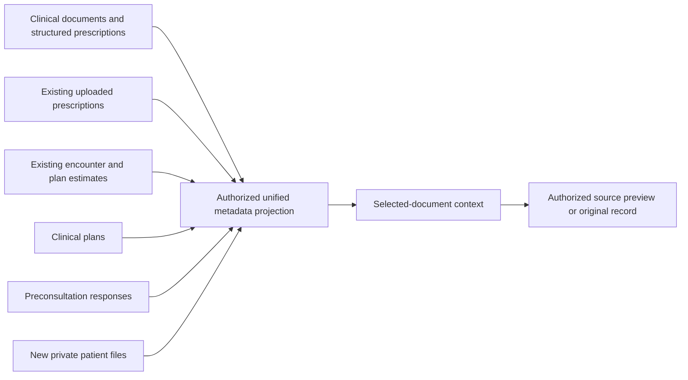

# Patient Workspace — Phase 1: unified documents

## Approved scope and technical design

Phase 1 introduces a patient-centered workspace with five sections: overview, consultations, documents, exams and treatments. The existing longitudinal chart and operational treatment workflows remain available. The initial navigation defaults to overview; documents are a first-class section, while exams show existing exam requests/files rather than an unimplemented laboratory comparison table. There is no patient monitor, portal, AI extraction or new commercial lifecycle.

The document view has three regions: patient context/navigation at left, searchable list/table in the center, and selected-document context/preview at right. On narrow screens these regions adapt without requiring a wide desktop canvas. Existing forms remain mounted where appropriate to retain unsaved edits; sensitive content resets when patient/unit context changes.

The technical choice is a federated read projection over existing authoritative sources, plus an additive store for newly imported files and categories. It avoids copying finalized documents, quotes, plans or questionnaire answers into a second library. This does not determine the architecture of later AI, laboratory series, presentation or portal features.

## Additive storage proposed before migration

Three new tables cover tenant-owned custom categories, immutable imported-document metadata, and append-only upload events. Categories can be multiple, using built-in stable classifications plus organization-owned additions; custom category creation is limited to individual SUPER_ADMIN/PARTNER_ADMIN identities. New files preserve private storage identity, original filename/type/size, server-computed SHA-256, patient/original-unit provenance and uploader/time. Existing clinical snapshots and applied migration history remain unchanged.

## Authorization and provenance

Source type participates in document identity, pagination and preview dispatch; UUID equality across different source tables does not imply the same document. Every listing/detail/file request checks organization, patient, original unit and current patient unit, plus the originating domain's capabilities. Commercial-only access must not disclose clinical titles, filters, counts or body text. Draft clinical documents remain author-only. Read auditing must succeed before metadata or original bytes are disclosed.

New imported files require an individual authorized clinical identity, bounded multipart input, validated supported file signatures and private storage. No client-supplied URL, hash or arbitrary storage pathname is trusted. The central display does not claim OCR, AI processing or professional result validation merely because a file was uploaded. Private storage and signature checks are not represented as antivirus scanning.

The native encounter-document print path also requires original and current patient unit access after transfer. A contextual preview cannot weaken source permissions or expose a reusable public storage URL. Sources without a file are identified as records, with a record link or read-only detail rather than an invented original PDF.

## Verification scope

Planned tests cover source federation, multiple/custom categories, filters/order/pagination, same-UUID source collisions, patient/tenant/unit isolation, draft privacy, commercial projections, fail-closed auditing, invalid/oversized files, private original access and upload failures/retries. Browser coverage includes the workspace navigation, retained treatment/consultation flows, document selection, context retention and responsive layout. Synthetic disposable PostgreSQL and the restricted runtime are used before Preview activation; no live accounts or patient data are needed.

Only migration 0070 is proposed for this phase. Previous migrations must retain their original hashes/timestamps. Production remains outside this rollout.

## Local verification and operational limits

The complete unit suite passed 364 tests. Disposable PostgreSQL integration passed 339 tests across 28 files, plus all three restricted-runtime provisioning checks. Browser verification covered 16 scenarios: 15 passed in the complete run; the clinical-plan scenario was adjusted to select Treatments again after reload and passed its focused rerun. Assertions were retained. The new document scenario exercised all five workspace sections, authenticated native preview in an iframe and a separate tab, read audit, and a 390-pixel mobile layout. Typecheck, production build and preview guards passed; lint retained only the six existing Fast Refresh warnings.

Upload storage is mocked in database tests; these results do not establish live private Blob upload/read availability. Existing Preview storage identifiers support the SDK's Vercel OIDC authentication; absence of a legacy token alone is not evidence of missing storage. No real accounts, patient records or messages were created for validation.

If COMMIT has been attempted, ambiguous connection failure must never trigger deletion of the original blob. An acknowledged retry can reuse the committed record. A process crash after storage upload but before database commit can leave an unreferenced private object; deterministic object names and overwrite prevention mean that retry may require reconciliation or a fresh upload identifier. Automatic orphan reconciliation is outside this phase.

Before activation, all 70 previously applied Preview migration hashes/timestamps were compared with the repository and matched. A new recovery-branch attempt was rejected by Neon's branch limit (HTTP 422); existing checkpoints were retained and are not a fresh recovery point for this rollout. The production baseline remained 61 migrations, latest `1794272400017`, and official deployment `dpl_4ag81mHUxsDZ7VaKqnrKKHqKrFkp`.

The additional lost-COMMIT-acknowledgement database test passed independently: the record remains committed, its blob is not deleted, and repeating the same upload returns the existing record without a second storage write. Restricted-runtime checks passed again. Migration `0070_patient_documents` was applied exclusively to Preview with a transactional history guard: 71 migrations, latest `1794272400027`, SHA-256 `395ad4a5f7bb5774c06857cb088a7cf1e7d2c5061372810ef7ed17281715d880`. The three new tables grant the runtime only SELECT/INSERT; no UPDATE, DELETE or TRUNCATE. Production was checked read-only and remained unchanged.

## Preview release verification

Implementation commit `d47a3eea08ecf9b95c4185ab32daf9a79e6578c4` reached READY at `https://allik-e7jiu2eqv-atp-mkt.vercel.app`. The deployed document-list and file endpoints reject the shared Preview identity with 403, while the existing products catalog remains accessible. Storage metadata confirms that the connected Preview Blob store is available and private in `gru1`; actual provider upload/download with an individual clinical session still requires operational validation. The official production alias remains on the baseline deployment above. These deployment checks do not replace the disposable authenticated browser scenarios or claim an external audit.
