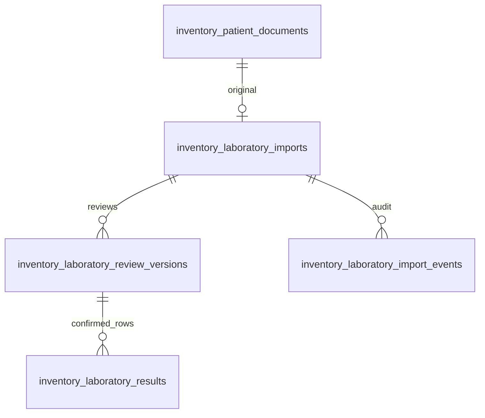

# Patient Workspace — Phase 2: laboratory extraction and human review

## Authorized scope and design

This increment follows the approved diagnosis/proposal: retain the Phase 1 private PDF as the authoritative original, add review beside that PDF, and separate provider extraction from human-confirmed results. No longitudinal chart, universal target ranges, automatic diagnostic interpretation, patient portal or presentation monitor is introduced. Production is outside this rollout.

The current document center, immutable file/hash/provenance, organization/current-and-original-unit authorization, clinical access audit, UI controls and reserved synthetic Preview operator are reused. The native PDF viewer requires its PDF iframe to allow the browser's native PDF component; generated HTML previews retain their sandbox. PDF bytes are fetched through the authorized route and represented only as a revocable in-memory blob URL, never a public Blob link.

Four additive tables were proposed before migration:

Imports hold a bounded draft, state/version, processing attempt/deadline, source SHA-256 and the latest validated revision pointer. Successful provider output is separately preserved as immutable extracted_payload; edits do not overwrite it. Review snapshots, result rows and events are append-only. A correction reopens a draft, resets patient/row confirmations and creates another sealed version; previous results remain intact. The latest review pointer prevents corrections from becoming duplicate active observations in the future longitudinal view.

The draft records literal names/results/units/references, collection/result dates, laboratory, method, material, page, source excerpt and uncertainty. Inequalities, decimal commas and qualitative results are retained. No unit conversion, matching of potentially incompatible tests, reference interpretation or calculated trend is performed. Missing values remain empty; dates are validated rather than guessed.

## UI and workflow

Select an imported PDF in Documents or Exams and choose **Conferir resultados laboratoriais**. The original appears at left and a compact editable table at right; mobile uses Original/Results tabs without clearing the draft. Additional source/method/date fields expand per row. The user can add/remove rows, mark rows reviewed, save a draft, consult previous immutable versions and reopen confirmed results for correction.

State is explicit: WAITING, PROCESSING, READY_REVIEW, VALIDATED or FAILED. Saving a draft does not publish results. Confirmation requires the patient/source checkbox, nonempty test names/results, explicit confirmation of every row and resolution of uncertainty. Validation atomically inserts a review snapshot, its result rows, latest pointer and event. Operation IDs replay a completed validation instead of duplicating results. Optimistic versions reject stale concurrent edits.

Read and write authorization checks the organization, source patient, original document unit and current patient unit. Clinical read audit must succeed before disclosure. Finance/integration identities cannot access the flow. The explicitly authorized reserved shared operator works only inside the existing synthetic Preview boundary; production still requires individual clinical access.

## AI execution and limits

The provider adapter uses the installed AI SDK 7.0.143 (generateText + Output.object) through explicitly configured Vercel AI Gateway or direct OpenAI Responses. There are no tools/agents or PDF-provided instructions to execute. Strict output validation rejects malformed results. The server rereads the private original, bounds it to 4 MiB and verifies its SHA-256 before any provider request. Provider-supplied confirmations are forcibly reset.

LAB_EXTRACTION_ENABLED=true and a compatible live-catalog model ID in LAB_EXTRACTION_MODEL are both required. There is deliberately no guessed model default. Vercel OIDC or an environment-specific server credential supplies Gateway authentication. Missing configuration leaves manual review available and does not pretend extraction succeeded. Never expose credentials or source file contents in logs.

Extraction runs on explicit request, with a 150-second inference deadline (60 seconds per textual batch), no SDK retries and at most 16,000 output tokens/200 rows. It is not a durable background worker. A persisted attempt prevents duplicate requests; a lease older than 240 seconds permits a new attempt. Late responses cannot replace a newer attempt, and an edited draft cannot be overwritten by extraction. A failed/aborted processing attempt retains the original and permits manual review or explicit retry. Recheck current actor and source scopes before publishing an extraction response.

Shared atomic counters limit requests to six extractions per organization/hour and twenty/day; replay of an existing attempt does not consume another provider call. These are test-rollout limits, not a billing budget or a guarantee of extraction accuracy. Production/provider commercial activation is a separate release decision.

## Verification and activation

Use only disposable PostgreSQL and synthetic PDFs for automated verification. Provider and Blob calls are mocked in database tests; the browser test supplies a synthetic PDF at its storage boundary while the application API, restricted role and database remain real. A provider live test must be distinguished from these results. No real users or patient data are required.

Migration 0071_laboratory_review adds only the four new tables, indexes and guards. Every previous migration hash/timestamp must match Preview before activation. Triggers preserve provenance, legal state/version transitions, immutable provider output and sealed reviews/results. Deferred seals require append-only events for each import version and matching result rows for each published review. The runtime receives normal mutations only for the draft workflow; history remains SELECT/INSERT only.

## Verification record — 2026-10-19

- Typecheck and build passed; lint has no errors and retains the six existing Fast Refresh warnings.
- Unit tests: 373 passed. Disposable PostgreSQL integration tests: 349 passed, plus runtime provisioning 3/3. Preview/build guards: 8/8.
- The dedicated laboratory browser scenario passed on desktop/mobile with native PDF rendering, explicit confirmation, immutable publication and correction. Blob/provider boundaries are synthetic/mocked; this is not evidence of live AI extraction or upload.
- Preview migration activated after all 71 previous hashes/timestamps matched. Journal now has 72 entries, latest 1794272400028. Migration 0071 SHA-256: 06e3f3edfdeb7d0616cf8fabda833c57cab0b7d65a547cb7a6653c1c3ed8c60a.
- A fresh no-compute recovery branch was refused by Neon with HTTP 422 (branch quota); existing recovery branches were preserved. No branch was removed.
- Production remains at 61 migrations, latest 1794272400017, and deployment dpl_4ag81mHUxsDZ7VaKqnrKKHqKrFkp. No production mutation is part of this release.

- Full restricted-role browser suite: 17/17 passed. The production bundle beta scenario passed synthetic migration preservation, individual access and scope checks, immutable PDFs, session revocation and disposable backup/restore. This does not certify remote production recovery.
- Initial Preview deployment of implementation commit 272d67ffde941390273f1f2673c18a3fa63780d3 reached READY. Its authorized model-catalog route returned HTTP 200 and the reserved synthetic operator session returned SUPER_ADMIN/sharedPreviewOperator=true.
- Live Gateway catalog confirmed google/gemini-3.8-flash; [official PDF input documentation](https://vercel.com/ai-gateway/models/gemini-3.8-flash) confirms file-part support. Catalog prices at verification: $0.75 input/$3.75 output per million tokens. LAB_EXTRACTION_MODEL and LAB_EXTRACTION_ENABLED were configured exclusively for Preview + feature/allik-patients; no production variable was changed.
- Live extraction remains operationally unverified: local deployment requests are denied by this execution environment's network policy, while the available protected-deployment connector supports GET only. A successful catalog request is not evidence of provider billing/authentication or extraction. Complete the synthetic PDF upload → explicit extraction → human validation test in Preview before considering this integration homologated. Manual review remains usable if the provider rejects the request.

### Provider diagnosis and direct OpenAI option

The adapter supports explicit Gateway or direct OpenAI selection; see [cost comparison and verification plan](laboratory-ai-provider-options.md). Failures now retain fixed categories for source access, integrity, authentication, billing, verification, rate limits, rejected requests and invalid output. No raw provider response or patient content is logged. Direct OpenAI uses Responses with `store:false` and requires a Preview-only server key. No automatic paid fallback or automatic clinical publication was added. A read-only SUPER_ADMIN/Preview status probe checks credentials/credits without inference. Validation: 373 unit tests, 352 disposable integration tests and runtime provisioning 3/3 passed; typecheck/build passed, lint retains six existing warnings. No schema change or production activation.

Current evidence verification and the reproducible synthetic benchmark are described in [Etapa 2 — qualidade e evidências](laboratory-quality-stage2.md). These extend new extractions only; existing originals and sealed clinical history are not rewritten.
