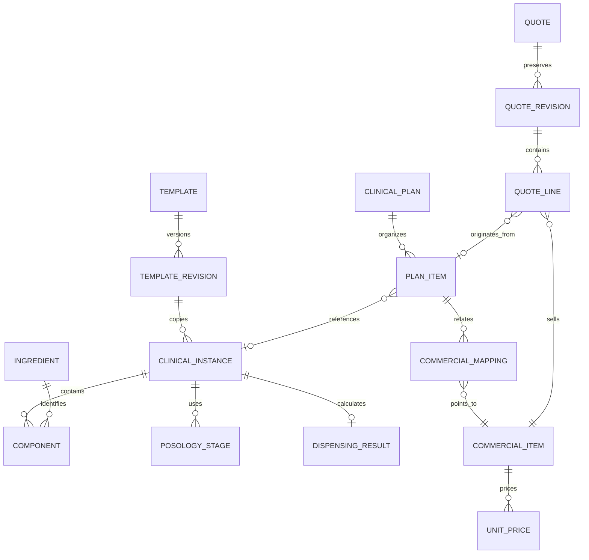

# Modular prescription engine — architecture and delivery roadmap

Baseline audited read-only: `ea3eba55ed178329d0abf9c84a545ae71a7804d4`, branch `feature/allik-patients`, 65 journal entries through 0064. This document records the incremental design presented before implementation. It is not an external audit or a production release.

## Existing boundaries

PostgreSQL/Drizzle/pg already provides organization memberships, unit access, patients, appointments and professional authorship. Inventory products are commercial SKUs, with suppliers, presentations, lots, balances, reservations, applications and append-only operational history. The application uses a restricted SQL identity plus backend authorization and pinned validation/immutability triggers; existing migrations do not define RLS policies.

Structured encounter prescriptions already reference optional products and structured doses/cadence. The formula composer currently stores personal versioned protocols and inserts reviewed text into the normal clinical-document draft. Finalized documents retain immutable snapshots and paper-signature mode. Attached patient prescriptions are a separate document-storage concern.

Existing quotes snapshot selected dose prices and internal costs, and support issue, approval/decline and manual payment registration. They currently originate from finalized structured encounter prescriptions; paid-quote activation creates product-specific treatments and schedules. Product-specific treatments also have a separate existing creation workflow. There is no general longitudinal clinical-plan aggregate independent of commerce.

Pricing presentations/doses are scoped to organization, not a full unit price book. Imported legacy sale prices lack the tenant/unit identity required of a future automatic pricing engine. They must remain reference data until explicitly mapped and validated. There is no general active-ingredient catalog, approved shared-template workflow, commercial service catalog, discount-limit policy, commissions engine, general sales ledger or transactional domain outbox in the inspected modules.

## Target modules

- **Catalog:** a common catalog service over typed ingredient, existing SKU and new service/procedure entities. Do not duplicate existing SKU identity or equate an ingredient with a commercial product; use explicit many-to-many associations.
- **Composition:** independent structured instances with stable item IDs, copied template revision and optional catalog references; retain existing prescription/document formats via adapters.
- **Posology:** deterministic calendar-based schedules, with start date/timezone, weekdays/times, duration, stages and patient instructions. Never infer a regimen from a medication name.
- **Dispensing:** prescribed administration units versus supplied presentations/packages; require explicitly registered package capacity and conversions, preserve unknown quantities and validate arithmetic server-side.
- **Clinical plan:** a header with typed intervention items referencing prescriptions, existing treatments, appointments and procedures. Financial status must not rewrite clinical intent.
- **Quote:** unit-scoped commercial mappings and effective prices, immutable revision snapshots, authorized discounts and optional items. Missing prices remain unavailable; show known subtotals and unresolved items. No automatic sale, reservation, charge or stock consumption.

Templates will extend existing personal protocol/version storage with category, description, PRIVATE/ORGANIZATION/INSTITUTIONAL visibility, optional unit restrictions, approval and explicit private-admin delegation. Copies must be independent; only immutable approved institutional revisions can be published. Exclude patient/appointment/contact identity from template payloads and require review of free text; no automated PII detector can guarantee that free text is anonymous.

Commercial mappings need a charge group and explicit included-versus-separately-billable components. Deduplicate by clinical origin/mapping/charge group, not solely SKU. Patient-facing and commercial projections must omit costs/margins and unnecessary clinical information, respectively. Use stable event/aggregate IDs, transactional outbox and idempotent consumers for future PRESCRIPTION_FINALIZED, QUOTE_CREATED, QUOTE_APPROVED, SALE_COMPLETED, SESSION_SCHEDULED, ITEM_ADMINISTERED and STOCK_CONSUMED integration. A paid quote is not automatically a sale or an administration.

## Delivery sequence

1. **M21A — Commercial access governance:** separate cost/pricing/lifecycle capabilities, allowlisted quote projections and unit-transfer checks. Preserve quote records/calculations and existing clinical workflows.
2. **M21B — Typed catalog and unit price books:** explicit ingredient/SKU/service identities and commercial mappings, additive migrations only after concrete schema review.
3. **M21C — Shared model library:** visibility, unit scopes, immutable revisions, approval and independent instances; compact save-template popover.
4. **M21D — General clinical plans and modular calculation:** composition/posology/dispensing adapters and calendar tests; preserve historical instances and documents.
5. **M21E — Probable quote:** snapshot revisions, absent-price states, included-insumable billing groups, decimal arithmetic and authorized commercial changes.
6. **M21F — Three-column RECEITA/ORÇAMENTO interface:** preserve edit state across tabs, approved backend projections, optional items and proposal generation.
7. **M21G — Integration contracts:** outbox/inbox, audit and replay semantics; reuse operational stock/application rules without coupling prescription edits to consumption.

Each delivery is tested in disposable PostgreSQL and synthetic Preview before any later explicit production rollout. Preserve applied migration hashes and existing IDs. No automatic migration/bootstrap during a build. Do not copy clinical production data into tests or infer doses, routes, compatibility, controlled status or prices.

## M21A role policy

| Capability                  | SUPER_ADMIN / PARTNER_ADMIN | INVENTORY_MANAGER | CLINICIAN | UNIT_MANAGER | FINANCE | VIEWER |
| --------------------------- | --------------------------- | ----------------- | --------- | ------------ | ------- | ------ |
| Read internal pricing costs | yes                         | yes               | no        | no           | yes     | no     |
| Manage pricing              | yes                         | yes               | no        | no           | no      | no     |
| Approve/decline quotes      | yes                         | no                | no        | yes          | yes     | no     |
| Record quote payment        | yes                         | no                | no        | no           | yes     | no     |

These capabilities remain subject to existing organization/unit authorization, individual-identity requirements for mutation and integration-token scopes. The responsible clinician retains the current ability to prepare/issue their quote with sale prices and without internal costs; this delivery does not yet move quote drafting to a general commercial plan. Existing stored quote JSON and internal audit history remain unchanged. This is a defined initial role policy, not a new per-user delegated-capabilities management UI.

M21A covers pricing/encounter-quote routes and related UI. It does not claim to remove acquisition information from all purchasing, supplier or inventory-operation modules; those need their own capability review as the commercial domain expands. It does not create shared templates, service pricing, general plans, discounts, sales or the new quote tab yet.

## M21A verification

Implemented through backend/frontend/test agent work and primary-agent integration. New response allowlists remove unrecognized nested fields as well as known cost fields. Commercial-only quote responses omit detailed prescription/activation, medication dose fields and free-text commercial notes that may contain clinical material; commercial presentation identity, quantities and sale totals remain available. Existing internal snapshots/audit rows are not rewritten. Activation replay responses are also allowlisted.

Mutating quote actions check the appointment's original unit and patient's current unit inside the existing locked transaction. The caller needs both scopes after transfer; authorized readers require both scopes as well. Pricing management requires an individual authorized account; shared synthetic access and integration credentials cannot write prices. Integration scopes do not automatically inherit the newly introduced capabilities.

Validation passed: 244 unit/UI tests, 275 PostgreSQL integration tests, runtime provisioning/guard checks 3/3 and 11 browser E2E tests. Typecheck, build and lint passed; lint retains only the six pre-existing Fast Refresh warnings. New regression tests inspect raw JSON, injected unknown/nested fields, lifecycle capabilities and tenant/unit-transfer denial. Existing pricing tests now use a synthetic individual administrator rather than the shared demo writer, matching the tightened policy.

No migration was generated or applied. Deployment scope is exclusively the feature-branch Preview. Production remains pinned to its earlier deployment; no user creation, credential changes, email or clinical production-data access was required.
